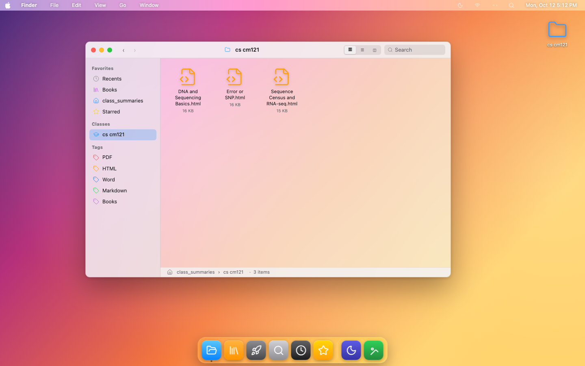
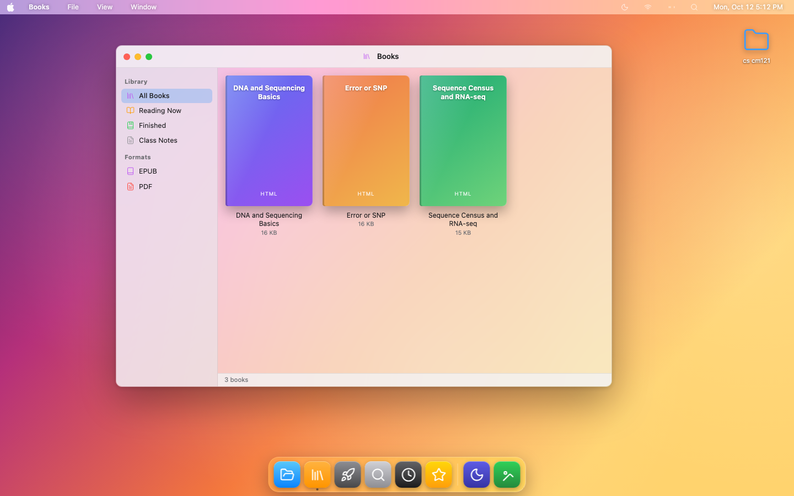
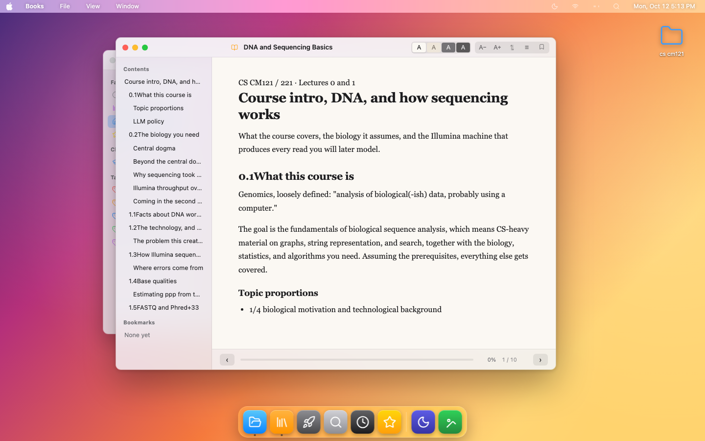
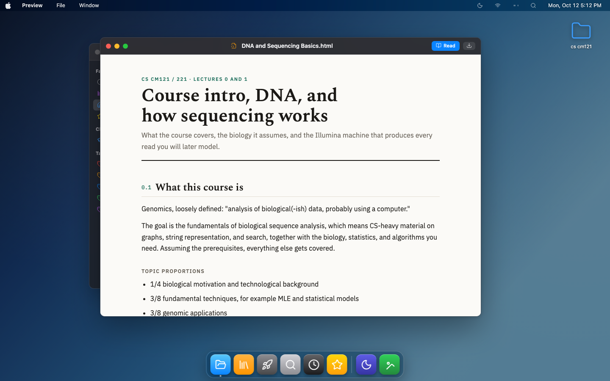
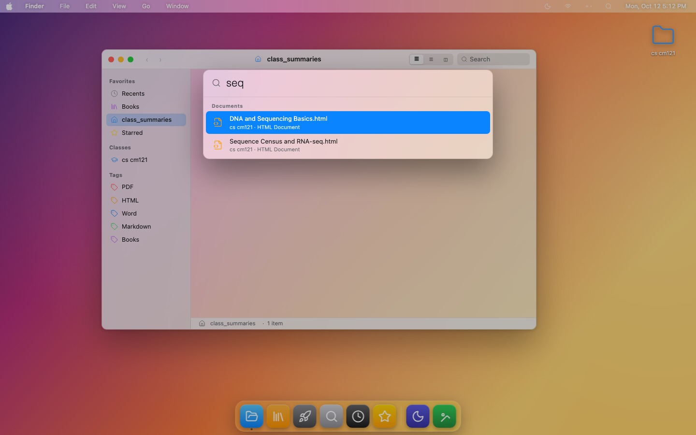
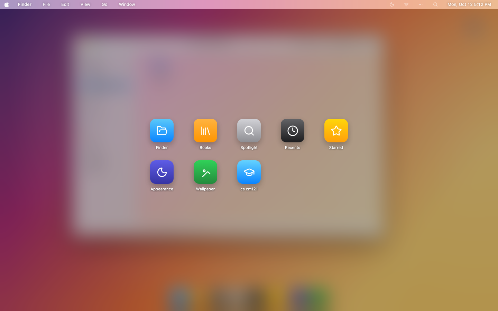

# macOS Class Summaries

A macOS desktop that runs in the browser, for reading and organising class notes.
Point it at a folder of summaries — one subfolder per class — and it gives you a
Finder to browse them and a Books app to read them.



Everything runs locally from a static folder. No build step, no dependencies to
install, no network calls: your notes never leave your machine.

---

## Reading

**Books** is the reading system, and it shelves *every* document — EPUBs, PDFs and
your class summaries alike, each with a generated cover and a progress bar.



Opening one gives a real paged reader: contents built automatically from the
document's own headings, bookmarks, four page themes (light, sepia, gray, dark),
text sizing, a scrubbable progress bar, a scroll-vs-page toggle, and a reading
position that is remembered per document.



EPUBs are rendered with [epub.js](https://github.com/futurepress/epub.js) and track
progress by CFI. HTML, Markdown, Word and text files are paginated with CSS columns.
LaTeX is typeset with [KaTeX](https://katex.org), so maths in lecture notes comes out
properly set rather than as raw `\(...\)` source.

Select any document and a **Read** button appears in the Finder toolbar. It is also
in the Preview title bar, in Quick Look, in column view, and on right-click.

## Browsing

Finder has a sidebar of Favorites, Classes and Tags; icon, list and column views;
a breadcrumb path bar; back/forward history; sortable columns; live search; starring;
Get Info; and Quick Look on <kbd>Space</kbd>.

Preview opens a document with its own styling intact, in light or dark:



## The desktop

Boot screen, translucent menu bar with working app menus, five wallpapers, desktop
icons, a Dock with magnification and running-app indicators, notifications, and
light/dark appearance. Windows drag, resize, zoom, minimise with a shrink animation,
and layer by focus.

| Spotlight (<kbd>⌘K</kbd>) | Launchpad |
|---|---|
|  |  |

---

## Running it

```bash
git clone https://github.com/nothing17777/macOS_Class_Summaries.git
cd macOS_Class_Summaries
./open-mac.command
```

That rescans your files, serves the folder on localhost and opens it in your browser.
Opening `index.html` straight from disk will **not** work — browsers block local file
reads over `file://`, so the launcher (or any static server) is required.

## Adding notes

Drop files anywhere under the project folder, one folder per class:

```
macOS_Class_Summaries/
  cs cm121/
    DNA and Sequencing Basics.html
    Error or SNP.html
  math 170a/
    week1.pdf
    notes.md
```

Supported: `.html .pdf .docx .md .txt .csv .rtf .tex .epub .pptx .xlsx` and more.
New files show up after a rescan — **View ▸ Rescan Files**, <kbd>⌘R</kbd>, or relaunch.

## Keyboard

| | |
|---|---|
| <kbd>⌘K</kbd> / <kbd>⌘Space</kbd> | Spotlight |
| <kbd>⌘N</kbd> | New Finder window |
| <kbd>⌘B</kbd> | Books |
| <kbd>⌘1</kbd> <kbd>⌘2</kbd> <kbd>⌘3</kbd> | Icon / List / Column view |
| <kbd>Space</kbd> | Quick Look |
| <kbd>⌘W</kbd> / <kbd>⌘M</kbd> | Close / minimise |
| <kbd>←</kbd> <kbd>→</kbd> | Turn pages in the reader |

## Deep links

The desktop can be opened in a given state, which is handy for bookmarks:

```
#folder=cs%20cm121                     open a class folder
#read=cs%20cm121/Error%20or%20SNP.html open a document in the reader
#open=<path>                           open it in Preview
#app=books                             open the Books library
#find=bayes                            open Spotlight on a query
#dark=1&wall=sonoma                    set appearance and wallpaper
```

## Layout

```
index.html            the desktop
open-mac.command      launcher
.finder/app.js        window manager, Finder, Books, readers
.finder/style.css     styling
.finder/scan.py       builds manifest.json from your folders
.finder/icons/        Lucide icons
.finder/vendor/       epub.js, KaTeX, marked, mammoth, JSZip
docs/screenshots/     the images above
```

`scan.py` walks the project folder and writes `.finder/manifest.json`; the app reads
that single file to build the tree. Reading progress, bookmarks, starred files and
appearance live in `localStorage`.

## Credits

[Lucide](https://lucide.dev) icons (ISC) · [epub.js](https://github.com/futurepress/epub.js) (BSD-2)
· [KaTeX](https://katex.org) (MIT) · [marked](https://marked.js.org) (MIT)
· [mammoth.js](https://github.com/mwilliamson/mammoth.js) (BSD-2) · [JSZip](https://stuk.github.io/jszip/) (MIT)

Not affiliated with Apple. The interface is an homage; no Apple assets are used.
